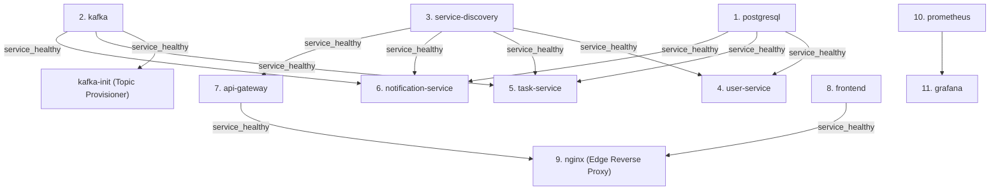

# Production Docker Compose Configuration Reference

| Field | Value |
|---|---|
| **Document ID** | DOC-DEP-003 |
| **Title** | Production Docker Compose Configuration Reference |
| **Project** | Task Management System – Microservices Architecture |
| **Target File** | `docker-compose.prod.yml` |
| **Status** | Approved Production Baseline |
| **Traceability Reference** | ADR-001, ADR-002, ADR-003, ADR-004, ADR-006, ADR-008, DOC-INF-005, RULE-03, RULE-04 |

---

## 1. Executive Summary

`docker-compose.prod.yml` is the single authoritative production deployment manifest for the Task Management System on the Hostinger VPS. It orchestrates 11 core application and infrastructure containers plus 1 transient initialization container on the dedicated `taskmanager-network` software bridge.

---

## 2. Complete Service Inventory & Port Binding Topology

| Service Name | Container Name | Image / Build Context | Internal Port | Host Port Binding | Healthcheck Probe |
|---|---|---|---|---|---|
| `postgresql` | `taskmanager-postgresql` | `postgres:16-alpine` | `5432` | `127.0.0.1:5432:5432` (Loopback only) | `pg_isready -U postgres` |
| `kafka` | `taskmanager-kafka` | `apache/kafka:3.7.0` | `9092` | **None** (Concealed inside network) | `kafka-broker-api-versions.sh` |
| `kafka-init` | `taskmanager-kafka-init` | `apache/kafka:3.7.0` | N/A | **None** (Exits 0 upon topic creation) | Relies on kafka health |
| `service-discovery` | `taskmanager-discovery` | `service-discovery/Dockerfile` | `8761` | `127.0.0.1:8761:8761` (Loopback only) | `curl -f http://localhost:8761/actuator/health` |
| `api-gateway` | `taskmanager-api-gateway` | `api-gateway/Dockerfile` | `8080` | **None** (Routed via Nginx) | `curl -f http://localhost:8080/actuator/health` |
| `user-service` | `taskmanager-user-service` | `user-service/Dockerfile` | `8081` | **None** (Routed via Gateway) | `curl -f http://localhost:8081/actuator/health` |
| `task-service` | `taskmanager-task-service` | `task-service/Dockerfile` | `8082` | **None** (Routed via Gateway) | `curl -f http://localhost:8082/actuator/health` |
| `notification-service` | `taskmanager-notification-service` | `notification-service/Dockerfile` | `8083` | **None** (Routed via Gateway) | `curl -f http://localhost:8083/actuator/health` |
| `frontend` | `taskmanager-frontend` | `frontend/Dockerfile` | `80` | **None** (Routed via Nginx) | `wget -q -O - http://localhost:80/healthz` |
| `prometheus` | `taskmanager-prometheus` | `prom/prometheus:v2.51.0` | `9090` | `127.0.0.1:9090:9090` (Loopback only) | Built-in process |
| `grafana` | `taskmanager-grafana` | `grafana/grafana:10.4.0` | `3000` | `127.0.0.1:3001:3000` (Loopback only) | Built-in process |
| `nginx` | `taskmanager-nginx` | `nginx:1.25-alpine` | `80`, `443` | **`0.0.0.0:80:80`**, **`0.0.0.0:443:443`** | `wget -q -O - http://localhost:80/healthz` |

---

## 3. Dependency Graph & Startup Sequencing

Containers start in strict topological order to eliminate connection drops and Flyway migration race conditions:



---

## 4. Volume Persistence & Data Isolation

```
Hostinger VPS Persistent Storage
│
├── taskmanager_postgres_data    ───► PostgreSQL 16 Cluster (/var/lib/postgresql/data)
│                                      ├── user_db (user_app)
│                                      ├── task_db (task_app)
│                                      └── notification_db (notification_app)
│
├── taskmanager_kafka_data       ───► Kafka KRaft Log Segments (/var/lib/kafka/data)
│                                      ├── task-events (3 partitions)
│                                      └── task-events.DLT (3 partitions)
│
├── taskmanager_prometheus_data  ───► Prometheus TSDB Metrics (/prometheus)
├── taskmanager_grafana_data     ───► Grafana DB & Preferences (/var/lib/grafana)
├── taskmanager_certbot_conf     ───► SSL/TLS Certs (/etc/letsencrypt)
└── taskmanager_certbot_www      ───► ACME Challenges (/var/www/certbot)
```

---

## 5. Network Subnet & DNS Resolution

- **Subnet**: `172.28.0.0/16` (`taskmanager-network`).
- **Internal Gateway**: `172.28.0.1`.
- **Inter-service resolution**: Handled dynamically by Docker Engine's built-in DNS resolver (`127.0.0.11`).
- Every container is equipped with both its canonical service name and its full descriptive container alias (e.g. `postgresql` and `taskmanager-postgresql`), guaranteeing compatibility with both application configuration files and monitoring scrapers.

