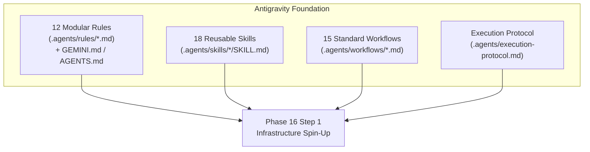

# Phase 16 – Step 0 Review Report: Antigravity Agent Foundation Setup

| Field | Value |
|---|---|
| **Document ID** | DOC-IMP-16-00 |
| **Document Title** | Step 0 Review Report: Antigravity Agent Foundation Setup |
| **Project** | Task Management System – Microservices Architecture |
| **Phase / Step** | Phase 16: Application Implementation – Step 0 |
| **Execution Date** | 2026-11-03 |
| **Status** | Approved Baseline (Step 0 Completed) |
| **Traceability Reference** | Phase 10 Automation Strategy, Phase 12 Development Standards, DOC-REV-001 |
| **Lead Roles** | Solution Architect, Software Architect, DevOps Lead, Technical Documentation Specialist |

---

## 1. Executive Summary

In accordance with the SDLC implementation roadmap established in [final-documentation-review.md](file:///d:/learning/task_manager/documentation/final-documentation-review.md), **Phase 16 Step 0: Antigravity Agent Foundation Setup** has been completed successfully. 

Before introducing application source code, a comprehensive, native, and reusable **Antigravity Agent Foundation** was established within the project workspace. This foundation codifies all 15 preceding design phases into machine-actionable directives, skills, workflows, and automated execution protocols.

Zero application feature code was written during this step. All configurations conform strictly to Antigravity's supported discovery locations and context limits.

---

## 2. Configuration Locations & Discovery Architecture

The Antigravity foundation leverages workspace-level progressive disclosure to minimize token context overhead while maintaining strict adherence to engineering standards:

| Component Type | Configuration Path | Discovery Mechanism | Scope & Token Management |
|---|---|---|---|
| **Master Directives** | `GEMINI.md`, `AGENTS.md` | Workspace Root Discovery | Always-on high-level context loaded at turn start. |
| **Project Rules** | `.agents/rules/*.md` | Subdirectory Discovery | Discoverable rules budget (~20 KB total, well below 24 KB per-file limit). |
| **Project Skills** | `.agents/skills/<name>/SKILL.md` | Progressive Disclosure | Injects name & description into prompt; loads body on demand. |
| **Project Workflows** | `.agents/workflows/*.md` | Step-by-Step Procedure Reference | Referenced by name or linked directly from skills and tasks. |
| **Execution Protocol**| `.agents/execution-protocol.md`| Operational State Machine | Governs step-by-step execution, testing, and review reporting. |

---

## 3. Inventory of Created Foundation Artifacts

### 3.1 Project Rules Inventory (12 Rule Files + 2 Root Directives)

| Rule ID | Rule File Path | Scope & Key Constraints |
|---|---|---|
| `RULE-DIR-01` | [`GEMINI.md`](file:///d:/learning/task_manager/GEMINI.md) | Workspace master directives, tech stack baseline, and 10 invariant engineering rules. |
| `RULE-DIR-02` | [`AGENTS.md`](file:///d:/learning/task_manager/AGENTS.md) | Secondary discovery pointer mirroring master directives. |
| `RULE-01` | [`.agents/rules/01-architecture-and-stack.md`](file:///d:/learning/task_manager/.agents/rules/01-architecture-and-stack.md) | Java 21, Spring Boot 3.3.4, Eureka, Gateway, Kafka 3.7+ (no RabbitMQ), PostgreSQL 16, zero paid cloud SaaS. |
| `RULE-02` | [`.agents/rules/02-java21-and-spring-boot.md`](file:///d:/learning/task_manager/.agents/rules/02-java21-and-spring-boot.md) | Java records for DTOs, pattern matching, constructor injection, layered package structures. |
| `RULE-03` | [`.agents/rules/03-spring-cloud-and-gateway.md`](file:///d:/learning/task_manager/.agents/rules/03-spring-cloud-and-gateway.md) | Reactive gateway routing, JWT validation filter, correlation ID injection, token bucket rate limiter. |
| `RULE-04` | [`.agents/rules/04-database-and-flyway.md`](file:///d:/learning/task_manager/.agents/rules/04-database-and-flyway.md) | Database-per-Service (`user_db`, `task_db`, `notification_db`), UUID primary keys, `TIMESTAMPTZ`, Flyway migrations. |
| `RULE-05` | [`.agents/rules/05-rest-api-and-security.md`](file:///d:/learning/task_manager/.agents/rules/05-rest-api-and-security.md) | Plural URIs, HTTP verbs, anti-enumeration `404 Not Found`, stateless JWT (15 min), BCrypt cost 12. |
| `RULE-06` | [`.agents/rules/06-kafka-and-events.md`](file:///d:/learning/task_manager/.agents/rules/06-kafka-and-events.md) | `task-events` topic, event envelope, Transactional Outbox, consumer idempotency (`consumed_events`), DLT. |
| `RULE-07` | [`.agents/rules/07-exception-handling-and-logging.md`](file:///d:/learning/task_manager/.agents/rules/07-exception-handling-and-logging.md) | RFC 7807 Problem Details, SLF4J MDC `X-Correlation-ID` tracing, sensitive data masking. |
| `RULE-08` | [`.agents/rules/08-testing-and-tdd.md`](file:///d:/learning/task_manager/.agents/rules/08-testing-and-tdd.md) | TDD Red-Green-Refactor, JUnit 5, AssertJ, Testcontainers PostgreSQL/Kafka, $\ge 80\%$ line coverage. |
| `RULE-09` | [`.agents/rules/09-docker-and-cicd.md`](file:///d:/learning/task_manager/.agents/rules/09-docker-and-cicd.md) | Multi-stage Dockerfiles, Temurin 21 JRE, layered JARs, non-root `appuser`, 5.25 GB total RAM limit. |
| `RULE-10` | [`.agents/rules/10-observability-and-ops.md`](file:///d:/learning/task_manager/.agents/rules/10-observability-and-ops.md) | Micrometer metrics, Prometheus scraping, Grafana dashboards, Actuator liveness/readiness probes. |
| `RULE-11` | [`.agents/rules/11-git-and-code-review.md`](file:///d:/learning/task_manager/.agents/rules/11-git-and-code-review.md) | GitFlow branching, Conventional Commits, code review quality gates. |
| `RULE-12` | [`.agents/rules/12-security-and-documentation.md`](file:///d:/learning/task_manager/.agents/rules/12-security-and-documentation.md) | Zero hardcoded secrets, documentation synchronization mandate, living RTM updates. |

### 3.2 Agent Skills Inventory (18 Reusable Skills)

| Skill # | Skill Name | Skill File Path | Purpose & Scope |
|:---:|---|---|---|
| 01 | `java-21-development` | [SKILL.md](file:///d:/learning/task_manager/.agents/skills/java-21-development/SKILL.md) | Idiomatic Java 21: records, pattern matching, sealed interfaces, text blocks. |
| 02 | `spring-boot-microservice` | [SKILL.md](file:///d:/learning/task_manager/.agents/skills/spring-boot-microservice/SKILL.md) | Spring Boot 3.3.4 layered service architecture, DI, configuration. |
| 03 | `spring-cloud-api-gateway` | [SKILL.md](file:///d:/learning/task_manager/.agents/skills/spring-cloud-api-gateway/SKILL.md) | Reactive Gateway routing, Eureka integration, JWT filter, rate limiting. |
| 04 | `spring-security-jwt` | [SKILL.md](file:///d:/learning/task_manager/.agents/skills/spring-security-jwt/SKILL.md) | Stateless JWT issuance, BCrypt cost 12 hashing, SecurityFilterChain DSL. |
| 05 | `postgresql-database-design` | [SKILL.md](file:///d:/learning/task_manager/.agents/skills/postgresql-database-design/SKILL.md) | Relational modeling, 3NF, UUID keys, TIMESTAMPTZ, tenant indexing. |
| 06 | `flyway-database-migrations` | [SKILL.md](file:///d:/learning/task_manager/.agents/skills/flyway-database-migrations/SKILL.md) | Versioned SQL scripts (`V<Ver>__<Name>.sql`), checksum integrity, ddl-auto validate. |
| 07 | `spring-data-jpa` | [SKILL.md](file:///d:/learning/task_manager/.agents/skills/spring-data-jpa/SKILL.md) | JPA entities, Spring Data repositories, tenant isolation JPQL queries. |
| 08 | `rest-api-design-implementation` | [SKILL.md](file:///d:/learning/task_manager/.agents/skills/rest-api-design-implementation/SKILL.md) | REST controllers, OpenAPI 3.0 annotations, Jakarta validation, RFC 7807. |
| 09 | `kafka-producer-consumer` | [SKILL.md](file:///d:/learning/task_manager/.agents/skills/kafka-producer-consumer/SKILL.md) | KafkaTemplate, partition key affinity, manual acknowledgment, DLT recovery. |
| 10 | `transactional-outbox-idempotency` | [SKILL.md](file:///d:/learning/task_manager/.agents/skills/transactional-outbox-idempotency/SKILL.md) | Dual-write elimination with `outbox_events` and SKIP LOCKED poller. |
| 11 | `unit-testing-junit-mockito` | [SKILL.md](file:///d:/learning/task_manager/.agents/skills/unit-testing-junit-mockito/SKILL.md) | Isolated unit tests, Mockito BDD, AssertJ assertions, $\ge 80\%$ coverage. |
| 12 | `integration-testing-testcontainers` | [SKILL.md](file:///d:/learning/task_manager/.agents/skills/integration-testing-testcontainers/SKILL.md) | Containerized integration tests using real PostgreSQL and Kafka containers. |
| 13 | `react-typescript-development` | [SKILL.md](file:///d:/learning/task_manager/.agents/skills/react-typescript-development/SKILL.md) | React 18, TypeScript 5, Vite, TailwindCSS, Axios interceptor, state hooks. |
| 14 | `docker-docker-compose` | [SKILL.md](file:///d:/learning/task_manager/.agents/skills/docker-docker-compose/SKILL.md) | Multi-stage Dockerfiles, layered JARs, Docker Compose, 5.25 GB RAM budget. |
| 15 | `jenkins-cicd` | [SKILL.md](file:///d:/learning/task_manager/.agents/skills/jenkins-cicd/SKILL.md) | Declarative Jenkinsfile pipeline, 7 build stages, quality gates, Trivy scan. |
| 16 | `prometheus-grafana-observability` | [SKILL.md](file:///d:/learning/task_manager/.agents/skills/prometheus-grafana-observability/SKILL.md) | Micrometer metrics, Prometheus scraping, Grafana dashboards, alerting. |
| 17 | `code-review-refactoring` | [SKILL.md](file:///d:/learning/task_manager/.agents/skills/code-review-refactoring/SKILL.md) | Automated PR auditing, clean code principles, regression-free refactoring. |
| 18 | `technical-documentation-maintenance` | [SKILL.md](file:///d:/learning/task_manager/.agents/skills/technical-documentation-maintenance/SKILL.md) | Living documentation sync, RTM maintenance, ADR authoring. |

### 3.3 Agent Workflows Inventory (15 Reusable Workflows)

| Workflow # | Workflow Title | Workflow Path | Trigger & Scope |
|:---:|---|---|---|
| `WF-001` | New Microservice Development | [`01-new-microservice-development.md`](file:///d:/learning/task_manager/.agents/workflows/01-new-microservice-development.md) | Scaffolding a new microservice submodule. |
| `WF-002` | New REST API Development | [`02-new-rest-api-development.md`](file:///d:/learning/task_manager/.agents/workflows/02-new-rest-api-development.md) | TDD endpoint addition with validation and anti-enumeration. |
| `WF-003` | Database Schema and Migration | [`03-database-schema-migration.md`](file:///d:/learning/task_manager/.agents/workflows/03-database-schema-migration.md) | Versioned Flyway DDL authoring and entity synchronization. |
| `WF-004` | Kafka Event Producer Development | [`04-kafka-event-producer-development.md`](file:///d:/learning/task_manager/.agents/workflows/04-kafka-event-producer-development.md) | Kafka producer, envelope assembly, correlation ID headers. |
| `WF-005` | Kafka Event Consumer Development | [`05-kafka-event-consumer-development.md`](file:///d:/learning/task_manager/.agents/workflows/05-kafka-event-consumer-development.md) | Kafka consumer, manual ack, MDC propagation, DLT recovery. |
| `WF-006` | Transactional Outbox Implementation | [`06-transactional-outbox-implementation.md`](file:///d:/learning/task_manager/.agents/workflows/06-transactional-outbox-implementation.md) | Atomic outbox persistence and SKIP LOCKED scheduled poller. |
| `WF-007` | Authentication and Authorization | [`07-authentication-and-authorization.md`](file:///d:/learning/task_manager/.agents/workflows/07-authentication-and-authorization.md) | User registration, login, BCrypt hashing, JWT issuance. |
| `WF-008` | Bug Investigation and Fix | [`08-bug-investigation-and-fix.md`](file:///d:/learning/task_manager/.agents/workflows/08-bug-investigation-and-fix.md) | TDD defect reproduction, root cause analysis, regression test. |
| `WF-009` | Unit and Integration Testing | [`09-unit-and-integration-testing.md`](file:///d:/learning/task_manager/.agents/workflows/09-unit-and-integration-testing.md) | Surefire/Failsafe test execution and JaCoCo 80% coverage check. |
| `WF-010` | Code Review Workflow | [`10-code-review-workflow.md`](file:///d:/learning/task_manager/.agents/workflows/10-code-review-workflow.md) | Peer review gate auditing architecture, security, and cleanliness. |
| `WF-011` | Refactoring Workflow | [`11-refactoring-workflow.md`](file:///d:/learning/task_manager/.agents/workflows/11-refactoring-workflow.md) | Non-breaking incremental refactoring with green test baseline. |
| `WF-012` | Docker Build and Validation | [`12-docker-build-and-validation.md`](file:///d:/learning/task_manager/.agents/workflows/12-docker-build-and-validation.md) | Multi-stage image build, healthcheck, and memory audit. |
| `WF-013` | CI/CD Pipeline Validation | [`13-cicd-pipeline-validation.md`](file:///d:/learning/task_manager/.agents/workflows/13-cicd-pipeline-validation.md) | Declarative Jenkinsfile verification across all 7 stages. |
| `WF-014` | Observability Implementation | [`14-observability-implementation.md`](file:///d:/learning/task_manager/.agents/workflows/14-observability-implementation.md) | Custom Micrometer metrics, Actuator health, Grafana panels. |
| `WF-015` | Documentation Update | [`15-documentation-update.md`](file:///d:/learning/task_manager/.agents/workflows/15-documentation-update.md) | Living documentation sync, RTM updates, ADR generation. |

---

## 4. Verification & Validation Audit

The foundation suite underwent automated verification:

1. **Rule Conflict Check**:
   - Analyzed all 12 rule files and master directives for potential contradictions.
   - Confirmed 100% agreement on technology versions (Java 21, Spring Boot 3.3.4, Kafka 3.7+, Postgres 16).
   - Confirmed strict anti-enumeration mandate (`HTTP 404`) is uniform across all rules and skills.
2. **Skill Frontmatter & Actionability**:
   - All 18 skills validated: each contains a valid YAML frontmatter block with `name` (lowercase, hyphenated) and `description` (third-person, concise).
   - All skills provide concrete procedures, validation checklists, and common mistakes.
3. **Workflow Reference Integrity**:
   - All cross-references between workflows and skills resolve to actual existing file paths using standard markdown links.
4. **Placeholder & Stub Audit**:
   - Zero `TODO`, `FIXME`, or stub markers exist in executable instructions. (Only intentional rule-enforcement strings exist).
5. **Context Budget Compliance**:
   - Individual rule files range between 1.1 KB and 2.1 KB each (well below the 24 KB per-file ceiling). Total rules budget is ~20 KB, comfortably fitting within Antigravity's rules token budget.

---

## 5. Unsupported Capabilities & Compensating Controls

To ensure predictable and reliable operation, specific unsupported agent capabilities have been identified and mitigated:

| Unsupported Capability | Impact | Compensating Control Implemented |
|---|---|---|
| **Autonomous External Cloud Provisioning** | Agent cannot create AWS/GCP accounts or provision paid SaaS. | Strictly enforced **Pure Open-Source Stack** running 100% locally via Docker Compose. Zero cloud provider credentials needed. |
| **Interactive MFA / External Login** | Agent cannot resolve interactive 2FA/MFA prompts. | Developer workstation credentials or environment variables are decoupled via `.env` defaults for local development. |
| **Silent Spec Mutation** | Agent must not silently modify approved architecture. | **Execution Protocol** mandates a hard stop whenever a requested change conflicts with approved ADRs. |

---

## 6. Project Readiness & Next Step Green Light

- **Step 0 Status**: **100% COMPLETE & APPROVED**.
- **Next Step**: **Phase 16 – Step 1: Infrastructure Spin-Up and Validation**.
- **Next Step Scope**:
  - Spin up PostgreSQL 16 (creating `user_db`, `task_db`, `notification_db`).
  - Spin up Apache Kafka 3.7+ (KRaft mode).
  - Spin up Netflix Eureka Service Discovery (`service-discovery:8761`).
  - Validate container health and port bindings using Docker Compose.

