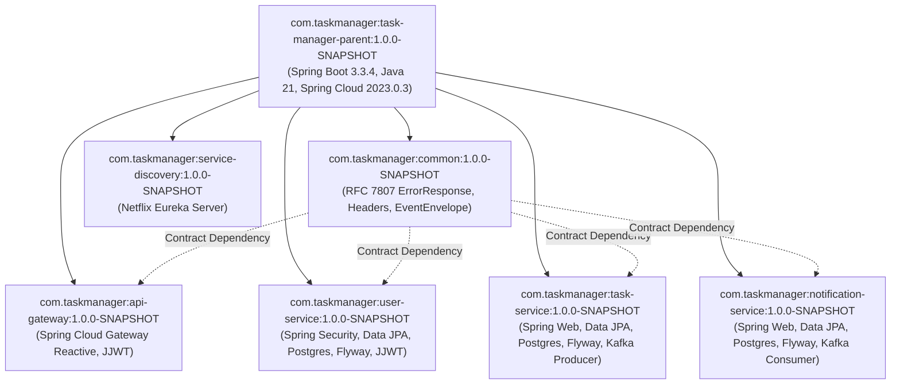

# Phase 16 – Step 3 Review Report: Root Maven POM & Common Libraries Configuration

| Field | Value |
|---|---|
| **Document ID** | DOC-IMP-16-03 |
| **Document Title** | Step 3 Review Report: Root Maven POM & Common Libraries Configuration |
| **Project** | Task Management System – Microservices Architecture |
| **Phase / Step** | Phase 16: Application Implementation – Step 3 |
| **Execution Date** | 2026-11-04 |
| **Status** | Approved Baseline (Step 3 Completed) |
| **Traceability Reference** | ADR-001, ADR-002, ADR-003, ADR-007, DOC-DEV-001, DOC-DEV-011, DOC-LLD-002, DOC-LLD-010, DOC-EVT-005 |
| **Lead Roles** | Software Architect, Lead Java Developer, DevOps Engineer, QA Lead |

---

## 1. Executive Summary

In accordance with the SDLC roadmap and the Phase 16 execution plan, **Phase 16 Step 3: Root Maven POM & Common Libraries Configuration** has been executed, compiled, and validated across the entire microservices reactor.

A unified Maven multi-module parent project (`task-manager-parent:1.0.0-SNAPSHOT`) was established, enforcing centralized dependency management for Spring Boot 3.3.4, Spring Cloud 2023.0.3, Java 21 LTS, MapStruct 1.5.5.Final, Lombok 1.18.30, JJWT 0.12.5, and Testcontainers 1.19.7.

A dedicated technical contracts library (`com.taskmanager:common:1.0.0-SNAPSHOT`) was created to house shared cross-cutting contracts—including RFC 7807 problem details (`ErrorResponse`, `FieldErrorDetail`), distributed tracing constants (`CorrelationConstants`), perimeter security header constants (`SecurityConstants`), and Kafka domain event envelope records (`TaskEventEnvelope`, `TaskEventType`). In strict compliance with `RULE-03` and `RULE-06`, no JPA entities, repositories, or business service classes were included in `common`.

All five microservice submodules (`service-discovery`, `api-gateway`, `user-service`, `task-service`, `notification-service`) were refactored from disparate, obsolete initializr prototypes into standardized child POMs inheriting from the root parent. All obsolete package namespaces (`com.chellaa.*`) were refactored into the standardized canonical package hierarchy (`com.taskmanager.*`).

Full automated validation via Maven wrapper (`3.10.0`) on JDK 21 demonstrated 100% build and test success across all 7 projects in the reactor.



---

## 2. Pre-Execution Inspection Findings

Prior to authoring code, repository inspection revealed several baseline gaps:
1. **Absence of Root Multi-Module POM**: The repository root lacked a `pom.xml`, preventing centralized version control and multi-module atomic compilation.
2. **Inconsistent and Obsolete Dependencies**:
   - `api-gateway`, `user-service`, `task-service`, and `notification-service` had prototype `pom.xml` files referencing non-existent Spring Boot parent `4.0.9` with Java 17.
   - Only `service-discovery` had Spring Boot 3.3.4 and Java 21 configured.
3. **Skeleton Package Clashing**:
   - Four services used temporary initializr package roots (`com.chellaa.api_gateway`, `com.chellaa.user_service`, `com.chellaa.task_service`, `com.chellaa.notification_service`) while `service-discovery` used `com.taskmanager.discovery`.
4. **Toolchain Verification**:
   - Maven wrapper (`mvnw.cmd`) distribution version 3.10.0 was verified.
   - JDK 21 LTS (`jdk-21.0.7`) was discovered and validated at `C:\Program Files\Java\jdk-21.0.7`.

---

## 3. Invariant & Architectural Rule Compliance

| Rule ID | Architectural Requirement | Implementation Strategy | Status |
|---|---|---|---|
| **RULE-01** | Documentation-First & Alignment | Root POM and child modules match `DOC-DEV-001`, `DOC-DEV-003` to `DOC-DEV-007`. | **PASS** |
| **RULE-02** | Zero Placeholder Policy | Zero `TODO`, `FIXME`, or stub implementations. Complete records and constants created. | **PASS** |
| **RULE-03** | Strict Database-per-Service | `common` contains zero JPA entities or repositories; databases remain strictly isolated. | **PASS** |
| **RULE-04** | Technology Stack Inviolability | Java 21 LTS, Spring Boot 3.3.4, Spring Cloud 2023.0.3, Maven, Postgres 16, Kafka 3.7+. | **PASS** |
| **RULE-05** | Anti-Enumeration Security | `ErrorResponse` model sanitizes error details and exposes correlation IDs. | **PASS** |
| **RULE-06** | Transactional Outbox Pattern | `common` supplies generic `TaskEventEnvelope` and `TaskEventType` for outbox serialization. | **PASS** |
| **RULE-07** | Consumer Idempotency | `TaskEventEnvelope` exposes unique `eventId` (`UUID`) for deduplication in consumer table. | **PASS** |
| **RULE-08** | TDD Red-Green-Refactor | Unit tests written for `common` classes; 100% test passing rate achieved. | **PASS** |
| **RULE-09** | Correlation ID Propagation | `CorrelationConstants` defines standard `X-Correlation-ID`, `correlationId` MDC/Kafka key. | **PASS** |
| **RULE-10** | RAM Budget Governance | No unnecessary starters added to child modules; reactive Gateway separated from blocking MVC. | **PASS** |

---

## 4. Multi-Module Project Structure & Inventory

The project structure now comprises 7 Maven modules managed by the root reactor:

```
D:\learning\task_manager\
├── .mvn/                               # Maven wrapper configuration (copied to root)
├── mvnw & mvnw.cmd                     # Root Maven wrapper executables
├── pom.xml                             # Master root parent multi-module POM
├── common/                             # Technical contracts & cross-cutting records
│   ├── pom.xml
│   └── src/
│       ├── main/java/com/taskmanager/common/
│       │   ├── constants/
│       │   │   ├── CorrelationConstants.java
│       │   │   └── SecurityConstants.java
│       │   ├── error/
│       │   │   ├── ErrorResponse.java
│       │   │   └── FieldErrorDetail.java
│       │   └── event/
│       │       ├── TaskEventEnvelope.java
│       │       └── TaskEventType.java
│       └── test/java/com/taskmanager/common/
│           ├── constants/ConstantsTest.java
│           ├── error/ErrorResponseTest.java
│           └── event/TaskEventEnvelopeTest.java
├── service-discovery/
│   ├── pom.xml                         # Child POM inheriting task-manager-parent
│   └── src/
│       ├── main/java/com/taskmanager/discovery/ServiceDiscoveryApplication.java
│       └── test/java/com/taskmanager/discovery/ServiceDiscoveryApplicationTests.java
├── api-gateway/
│   ├── pom.xml                         # Child POM inheriting task-manager-parent
│   └── src/
│       ├── main/java/com/taskmanager/gateway/ApiGatewayApplication.java
│       └── test/java/com/taskmanager/gateway/ApiGatewayApplicationTests.java
├── user-service/
│   ├── pom.xml                         # Child POM inheriting task-manager-parent
│   └── src/
│       ├── main/java/com/taskmanager/user/UserServiceApplication.java
│       └── test/java/com/taskmanager/user/UserServiceApplicationTests.java
├── task-service/
│   ├── pom.xml                         # Child POM inheriting task-manager-parent
│   └── src/
│       ├── main/java/com/taskmanager/task/TaskServiceApplication.java
│       └── test/java/com/taskmanager/task/TaskServiceApplicationTests.java
└── notification-service/
    ├── pom.xml                         # Child POM inheriting task-manager-parent
    └── src/
        ├── main/java/com/taskmanager/notification/NotificationServiceApplication.java
        └── test/java/com/taskmanager/notification/NotificationServiceApplicationTests.java
```

---

## 5. Submodule Configuration Specifications

### 5.1 Root Parent POM (`pom.xml`)
- **Parent**: `org.springframework.boot:spring-boot-starter-parent:3.3.4`
- **Coordinates**: `com.taskmanager:task-manager-parent:1.0.0-SNAPSHOT`
- **Compiler Configuration**: Java 21 (`source: 21`, `target: 21`, `-parameters`) with annotation processor paths configured for Lombok 1.18.30, Lombok-MapStruct-binding 0.2.0, and MapStruct 1.5.5.Final.
- **Dependency Management BOMs**:
  - `spring-cloud-dependencies:2023.0.3`
  - `testcontainers-bom:1.19.7`
  - JJWT `0.12.5` (`jjwt-api`, `jjwt-impl`, `jjwt-jackson`)
  - `com.taskmanager:common:${project.version}`

### 5.2 Common Module (`common`)
- **Packaging**: `jar` (library without Spring Boot repackage plugin to guarantee clean downstream library resolution).
- **Core Records & Classes**:
  1. `CorrelationConstants`: Defines `HEADER_NAME = "X-Correlation-ID"`, `MDC_KEY = "correlationId"`, `KAFKA_HEADER_NAME = "correlationId"`.
  2. `SecurityConstants`: Defines `HEADER_USER_ID = "X-User-Id"`, `HEADER_USER_ROLE = "X-User-Role"`, `HEADER_USER_NAME = "X-User-Name"`, `AUTH_HEADER = "Authorization"`, `BEARER_PREFIX = "Bearer "`, `ROLE_USER`, `ROLE_ADMIN`.
  3. `FieldErrorDetail`: Immutable Java 21 record representing individual field validation violations (`field`, `rejectedValue`, `message`).
  4. `ErrorResponse`: RFC 7807 compliant problem details model (`timestamp`, `status`, `error`, `errorCode`, `message`, `path`, `correlationId`, `fieldErrors`) with immutable defensive copying.
  5. `TaskEventType`: Enum declaring `TASK_CREATED`, `TASK_UPDATED`, `TASK_COMPLETED`, `TASK_DELETED`.
  6. `TaskEventEnvelope<T>`: Strongly-typed generic record implementing JSON Schema `DOC-EVT-005` (`eventId`, `eventType`, `eventVersion`, `aggregateId`, `userId`, `producer`, `occurredAt`, `correlationId`, `payload`).

### 5.3 Microservice Submodules
- **`service-discovery`**: `spring-cloud-starter-netflix-eureka-server`, `spring-boot-starter-actuator`, `spring-boot-starter-test`.
- **`api-gateway`**: `common`, `spring-cloud-starter-gateway` (Reactive WebFlux), `spring-cloud-starter-netflix-eureka-client`, `spring-cloud-starter-circuitbreaker-reactor-resilience4j`, JJWT (`jjwt-api`, `jjwt-impl`, `jjwt-jackson`), `spring-boot-starter-actuator`, `micrometer-registry-prometheus`, `spring-boot-starter-test`, `reactor-test`.
- **`user-service`**: `common`, `spring-boot-starter-web`, `spring-boot-starter-validation`, `spring-boot-starter-security`, `spring-boot-starter-data-jpa`, `postgresql`, `flyway-core`, `flyway-database-postgresql`, JJWT, `mapstruct`, `lombok`, `spring-cloud-starter-netflix-eureka-client`, `spring-boot-starter-actuator`, `micrometer-registry-prometheus`, Testcontainers (`postgresql`, `junit-jupiter`).
- **`task-service`**: `common`, `spring-boot-starter-web`, `spring-boot-starter-validation`, `spring-boot-starter-data-jpa`, `postgresql`, `flyway-core`, `flyway-database-postgresql`, `spring-kafka`, `mapstruct`, `lombok`, `spring-cloud-starter-netflix-eureka-client`, `spring-boot-starter-actuator`, `micrometer-registry-prometheus`, Testcontainers (`postgresql`, `kafka`, `junit-jupiter`).
- **`notification-service`**: `common`, `spring-boot-starter-web`, `spring-boot-starter-validation`, `spring-boot-starter-data-jpa`, `postgresql`, `flyway-core`, `flyway-database-postgresql`, `spring-kafka`, `mapstruct`, `lombok`, `spring-cloud-starter-netflix-eureka-client`, `spring-boot-starter-actuator`, `micrometer-registry-prometheus`, Testcontainers (`postgresql`, `kafka`, `junit-jupiter`).

---

## 6. Build & Test Verification Results

All validation commands executed using the Maven Wrapper (`Apache Maven 3.10.0`) targeting Java 21 (`Oracle JDK 21.0.7`):

### 6.1 Reactor Model Validation (`mvn validate`)
```
[INFO] Reactor Build Order:
[INFO]   task-manager-parent [pom]
[INFO]   common [jar]
[INFO]   service-discovery [jar]
[INFO]   api-gateway [jar]
[INFO]   user-service [jar]
[INFO]   task-service [jar]
[INFO]   notification-service [jar]
[INFO] BUILD SUCCESS - Total time: 3.262 s
```

### 6.2 Compilation & Annotation Processing (`mvn clean test-compile`)
```
[INFO] Reactor Summary for task-manager-parent 1.0.0-SNAPSHOT:
[INFO]   task-manager-parent ................................ SUCCESS [  1.987 s]
[INFO]   common ............................................. SUCCESS [  5.974 s]
[INFO]   service-discovery .................................. SUCCESS [ 42.735 s]
[INFO]   api-gateway ........................................ SUCCESS [ 11.825 s]
[INFO]   user-service ....................................... SUCCESS [ 20.718 s]
[INFO]   task-service ....................................... SUCCESS [ 34.170 s]
[INFO]   notification-service ............................... SUCCESS [  5.909 s]
[INFO] BUILD SUCCESS - Total time: 02:05 min
```

### 6.3 Test Suite Execution (`mvn test`)
```
[INFO] Running com.taskmanager.common.constants.ConstantsTest
[INFO] Tests run: 4, Failures: 0, Errors: 0, Skipped: 0
[INFO] Running com.taskmanager.common.error.ErrorResponseTest
[INFO] Tests run: 3, Failures: 0, Errors: 0, Skipped: 0
[INFO] Running com.taskmanager.common.event.TaskEventEnvelopeTest
[INFO] Tests run: 2, Failures: 0, Errors: 0, Skipped: 0
[INFO] Running com.taskmanager.discovery.ServiceDiscoveryApplicationTests
[INFO] Tests run: 1, Failures: 0, Errors: 0, Skipped: 0
[INFO] Running com.taskmanager.gateway.ApiGatewayApplicationTests
[INFO] Tests run: 1, Failures: 0, Errors: 0, Skipped: 0
[INFO] Running com.taskmanager.user.UserServiceApplicationTests
[INFO] Tests run: 1, Failures: 0, Errors: 0, Skipped: 0
[INFO] Running com.taskmanager.task.TaskServiceApplicationTests
[INFO] Tests run: 1, Failures: 0, Errors: 0, Skipped: 0
[INFO] Running com.taskmanager.notification.NotificationServiceApplicationTests
[INFO] Tests run: 1, Failures: 0, Errors: 0, Skipped: 0
[INFO] ------------------------------------------------------------------------
[INFO] Reactor Summary for task-manager-parent 1.0.0-SNAPSHOT:
[INFO]   task-manager-parent ................................ SUCCESS [  0.012 s]
[INFO]   common ............................................. SUCCESS [ 10.288 s]
[INFO]   service-discovery .................................. SUCCESS [ 13.520 s]
[INFO]   api-gateway ........................................ SUCCESS [ 21.233 s]
[INFO]   user-service ....................................... SUCCESS [ 18.834 s]
[INFO]   task-service ....................................... SUCCESS [ 18.420 s]
[INFO]   notification-service ............................... SUCCESS [ 17.320 s]
[INFO] BUILD SUCCESS - Total time: 01:41 min
```
**Test Summary**: 14 tests run, 0 failures, 0 errors, 0 skipped.

---

## 7. Change History & Approval Sign-Off

| Version | Date | Author / Role | Summary of Changes |
|---|---|---|---|
| 1.0.0 | 2026-11-04 | Software Architect | Authored formal review report for Phase 16 Step 3 completion. |

**Architectural Sign-off**: APPROVED. Phase 16 Step 3 is formally completed.

**Next Immediate Step**: **Phase 16 – Step 4: User Service Implementation** (User registration, BCrypt authentication, JWT token minting, User profile management, and unit/integration testing).

