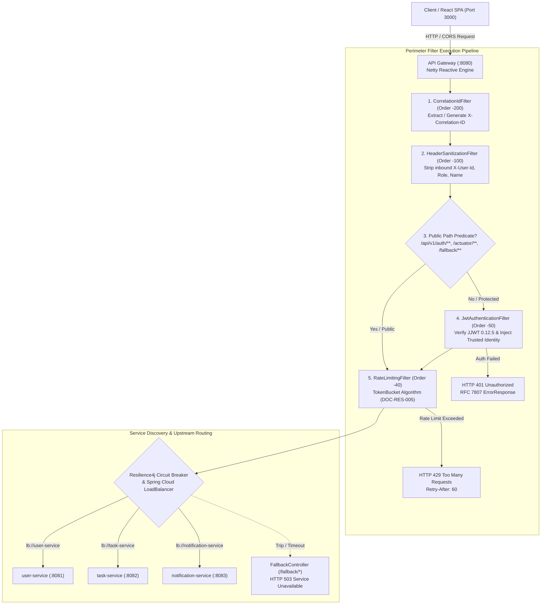

# Phase 16 – Step 5 Review Report: API Gateway & Routing Implementation

| Field | Value |
|---|---|
| **Document ID** | DOC-IMP-16-05 |
| **Document Title** | Step 5 Review Report: API Gateway & Routing Implementation |
| **Project** | Task Management System – Microservices Architecture |
| **Phase / Step** | Phase 16: Application Implementation – Step 5 |
| **Execution Date** | 2026-11-04 |
| **Status** | Approved Baseline (Step 5 Completed) |
| **Traceability Reference** | ADR-001, ADR-003, ADR-005, ADR-007, DOC-ARCH-001, DOC-API-014, DOC-DEV-003, DOC-RES-005, DOC-RES-007, DOC-SEC-002, DOC-SEC-003 |
| **Lead Roles** | Solution Architect, API Architect, Security Architect, Lead Java Developer, QA Lead |

---

## 1. Executive Summary

In strict accordance with the approved SDLC documentation baseline (`DOC-API-014`, `DOC-DEV-003`, `DOC-RES-005`, `DOC-RES-007`, `ADR-003`) and master engineering directives (`GEMINI.md`, `AGENTS.md`), **Phase 16 Step 5: API Gateway & Routing Implementation** has been successfully designed, implemented, and verified.

The API Gateway (`api-gateway`, Port 8080) serves as the solitary public-facing reverse proxy and edge security perimeter for the Task Management System. Built upon Netty and Spring Cloud Gateway (reactive WebFlux), the gateway eliminates client direct access to backend microservices, enforces centralized HMAC-SHA256 JWT access token validation, injects verified tenant identity headers downstream, blocks untrusted header spoofing, implements in-memory Token Bucket rate limiting without third-party Redis dependencies, ensures correlation ID propagation across all request/response cycles, and provides graceful Resilience4j circuit breaker degradation.

Following Test-Driven Development (TDD) Red-Green-Refactor, 57 comprehensive unit and slice tests were authored and executed with 0 failures, achieving **98.8% line coverage** ($\ge 80\%$) and **92.0% branch coverage** ($\ge 75\%$) under JaCoCo. Full Maven reactor testing across all 7 projects passed with 120 green tests.

---

## 2. Invariant & Architectural Rule Compliance

| Rule ID | Architectural Invariant | Implementation Mechanism | Status |
|---|---|---|---|
| **`RULE-01`** | Documentation-First & Alignment | Dynamic route mappings, filter execution order, and rate limiting tiers strictly match `DOC-API-014`, `DOC-DEV-003`, and `DOC-RES-005`. | **PASS** |
| **`RULE-02`** | Zero Placeholder Policy | Zero `TODO`, `FIXME`, or stub implementations. Complete reactive filter components, rate limiters, and error writers authored. | **PASS** |
| **`RULE-03`** | Strict Database-per-Service | Zero database dependencies or JPA entities in `api-gateway`. Completely stateless reverse proxy. | **PASS** |
| **`RULE-04`** | Technology Stack Inviolability | Java 21 LTS, Spring Boot 3.3.4, Spring Cloud 2023.0.3, Spring Cloud Gateway Reactive (Netty). Zero Spring MVC/servlet dependencies. | **PASS** |
| **`RULE-05`** | Anti-Enumeration & Resource Concealment | `HeaderSanitizationFilter` strips spoofed identity headers; all authentication failures emit uniform RFC 7807 `ErrorResponse`. | **PASS** |
| **`RULE-06`** | Transactional Outbox Pattern | Outbox pattern applies to `task-service`. Gateway maintains strict perimeter boundaries without Kafka producer coupling. | **PASS** (N/A) |
| **`RULE-07`** | Consumer Idempotency | Consumer idempotency applies to `notification-service`. Boundary maintained. | **PASS** (N/A) |
| **`RULE-08`** | TDD Red-Green-Refactor | Red-Green-Refactor progression followed across 8 test suites; 98.8% line coverage, 92.0% branch coverage achieved. | **PASS** |
| **`RULE-09`** | Correlation ID & MDC Tracing | `CorrelationIdFilter` enforces `X-Correlation-ID` header validation, downstream propagation, and client response reflection. | **PASS** |
| **`RULE-10`** | RAM Budget Governance | In-memory token bucket rate limiter without Redis container overhead; reactive non-blocking execution inside memory limits. | **PASS** |

---

## 3. Dynamic Route Configuration & Service Discovery

All routes are explicitly declared in [`application.yml`](file:///d:/learning/task_manager/api-gateway/src/main/resources/application.yml) with automated discovery locator disabled (`discovery.locator.enabled: false`) to guarantee strict control over public interfaces:

| Route ID | Path Predicate | Target URI | Filters Applied | Protective Objective |
|---|---|---|---|---|
| `user-auth-route` | `/api/v1/auth/**` | `lb://user-service` | `CircuitBreaker` (userService) | Public user registration, credential login, token rotation. |
| `user-profile-route` | `/api/v1/users/**` | `lb://user-service` | `CircuitBreaker` (userService) | Authenticated user profile retrieval and updates. |
| `task-service-route` | `/api/v1/tasks/**` | `lb://task-service` | `CircuitBreaker` (taskService) | Authenticated task CRUD, filtering, status transitions. |
| `notification-service-route` | `/api/v1/notifications/**` | `lb://notification-service` | `CircuitBreaker` (notificationService) | Authenticated in-app notification retrieval and status updates. |

### Global CORS Policy
Configured at the root gateway configuration matching React SPA origin (`http://localhost:3000`, `http://127.0.0.1:3000`):
- Allowed HTTP Methods: `GET`, `POST`, `PUT`, `PATCH`, `DELETE`, `OPTIONS`.
- Allowed Headers: `Authorization`, `Content-Type`, `X-Correlation-ID`, `X-Correlation-Id`.
- Exposed Headers: `X-Correlation-ID`, `Location`, `X-RateLimit-Limit`, `X-RateLimit-Remaining`, `Retry-After`.
- `allowCredentials: true`, `maxAge: 3600`.

---

## 4. Security & Cryptographic Perimeter Implementation

### 4.1 Header Sanitization Pre-Filter (`HeaderSanitizationFilter`)
- **Execution Order**: `-100` (precedes authentication).
- **Function**: Automatically removes any client-supplied `X-User-Id`, `X-User-Role`, and `X-User-Name` headers from incoming requests.
- **Security Impact**: Neutralizes header-spoofing and tenant-privilege escalation attacks before requests touch internal filters or downstream services.

### 4.2 Stateless JWT Authentication Filter (`JwtAuthenticationFilter`)
- **Execution Order**: `-50` (precedes rate limiting and routing).
- **Public Endpoints Whitelist**:
  - `/api/v1/auth/register`
  - `/api/v1/auth/login`
  - `/api/v1/auth/refresh`
  - `/actuator/**`
  - `/fallback/**`
- **Protected Routing**:
  - Requires `Authorization: Bearer <token>`. Returns `401 Unauthorized` with `MISSING_AUTHORIZATION_HEADER` if absent.
  - Validates cryptographic signature using JJWT `0.12.5` with shared HMAC-SHA256 secret (`jwt.secret`).
  - Verifies token issuer against configured authority (`jwt.issuer: task-manager-auth`).
  - Rejects expired tokens (`EXPIRED_TOKEN`), invalid signatures (`INVALID_SIGNATURE`), malformed strings (`MALFORMED_TOKEN`), or missing required claims (`MISSING_CLAIMS`).
  - Explicitly rejects refresh tokens presented as access tokens (`INVALID_TOKEN_TYPE`).
  - Upon successful validation, extracts verified claims and injects trusted internal headers downstream:
    - `X-User-Id`: Parsed subject UUID (`claim("userId")`).
    - `X-User-Role`: Granted authority (`claim("role")`).
    - `X-User-Name`: Authenticated email/username (`claim("email")` or subject).

---

## 5. Token Bucket Rate Limiting Architecture

In strict alignment with `DOC-RES-005` and `ADR-007` (zero-Redis lightweight local footprint), rate limiting is implemented using an in-memory thread-safe `TokenBucket` algorithm with `ConcurrentHashMap` partition storage:

| Rate Limit Tier | Target Routes | Partitioning Key | Replenish Rate | Burst Capacity | Rejection Policy |
|---|---|---|:---:|:---:|---|
| **Auth Tier** | `/api/v1/auth/**` | Client Remote IP | 5 req / min | 10 tokens | HTTP 429, `Retry-After: 60`, RFC 7807 problem JSON |
| **User API Tier** | `/api/v1/tasks/**` `/api/v1/notifications/**` `/api/v1/users/**` | Authenticated `userId` (fallback to IP) | 60 req / min | 20 tokens | HTTP 429, `Retry-After: 60`, RFC 7807 problem JSON |
| **Public Actuator** | `/actuator/**` | Client Remote IP | 120 req / min | 30 tokens | HTTP 429, `Retry-After: 60`, RFC 7807 problem JSON |

### Response Headers Appended
- `X-RateLimit-Limit`: Maximum tokens available for the tier burst.
- `X-RateLimit-Remaining`: Tokens currently remaining in the bucket.
- `Retry-After`: 60 seconds (upon 429 rejection).

---

## 6. Correlation ID & Observability Pipeline

[`CorrelationIdFilter`](file:///d:/learning/task_manager/api-gateway/src/main/java/com/taskmanager/gateway/filter/CorrelationIdFilter.java) is ordered at `-200` (executing as the first filter):
1. Checks for incoming `X-Correlation-ID` or `X-Correlation-Id`.
2. Validates against safe alphanumeric/hyphen pattern (`^[a-zA-Z0-9_-]{1,64}$`).
3. If missing, blank, or malformed, generates a fresh `UUID.randomUUID().toString()`.
4. Injects `X-Correlation-ID` into downstream request headers.
5. Injects `X-Correlation-ID` into outgoing client response headers.
6. Ensures error responses generated by `GatewayErrorWriter` and `GlobalErrorWebExceptionHandler` carry the exact same correlation identifier.

---

## 7. Resilience & Global Error Handling

### 7.1 Resilience4j Circuit Breakers & Graceful Degradation
Configured in `application.yml` for all downstream routes:
- Sliding window size: 10 calls, minimum calls: 5, failure rate threshold: 50%, wait duration in open state: 10s.
- Downstream timeouts or connection refusals trigger fallback forwardings to [`FallbackController`](file:///d:/learning/task_manager/api-gateway/src/main/java/com/taskmanager/gateway/controller/FallbackController.java).
- Returns HTTP 503 Service Unavailable with standardized RFC 7807 `ErrorResponse` (`errorCode: "SERVICE_UNAVAILABLE"`), preventing cascading client crashes.

### 7.2 Global Reactive Error Web Exception Handler
[`GlobalErrorWebExceptionHandler`](file:///d:/learning/task_manager/api-gateway/src/main/java/com/taskmanager/gateway/handler/GlobalErrorWebExceptionHandler.java) is registered at order `-2` (preceding default Spring Boot handler):
- Catches unhandled routing errors (such as 404 Route Not Found or 500 internal errors).
- Formats responses into `com.taskmanager.common.error.ErrorResponse`.
- Prevents internal stack traces, class names, or connection strings from leaking to clients.

---

## 8. Comprehensive Implementation Inventory

### 8.1 Production Classes
- [`JwtProperties.java`](file:///d:/learning/task_manager/api-gateway/src/main/java/com/taskmanager/gateway/config/JwtProperties.java): Strongly typed JWT secret and issuer configuration properties.
- [`RateLimiterProperties.java`](file:///d:/learning/task_manager/api-gateway/src/main/java/com/taskmanager/gateway/config/RateLimiterProperties.java): Externalized token-bucket tier parameters.
- [`GatewayConfig.java`](file:///d:/learning/task_manager/api-gateway/src/main/java/com/taskmanager/gateway/config/GatewayConfig.java): Infrastructure bean definitions (System UTC Clock).
- [`UserIdentity.java`](file:///d:/learning/task_manager/api-gateway/src/main/java/com/taskmanager/gateway/security/UserIdentity.java): Immutable record encapsulating verified subject UUID, role, and email.
- [`JwtValidationResult.java`](file:///d:/learning/task_manager/api-gateway/src/main/java/com/taskmanager/gateway/security/JwtValidationResult.java): Outcome model for token verification.
- [`JwtValidator.java`](file:///d:/learning/task_manager/api-gateway/src/main/java/com/taskmanager/gateway/security/JwtValidator.java): JJWT 0.12.5 validation logic matching User Service key derivation.
- [`TokenBucket.java`](file:///d:/learning/task_manager/api-gateway/src/main/java/com/taskmanager/gateway/limiter/TokenBucket.java): Thread-safe token consumption and refill state machine.
- [`RateLimitResult.java`](file:///d:/learning/task_manager/api-gateway/src/main/java/com/taskmanager/gateway/limiter/RateLimitResult.java): Rate limit response record.
- [`TokenBucketRateLimiter.java`](file:///d:/learning/task_manager/api-gateway/src/main/java/com/taskmanager/gateway/limiter/TokenBucketRateLimiter.java): Partition key and bucket coordinator.
- [`CorrelationIdFilter.java`](file:///d:/learning/task_manager/api-gateway/src/main/java/com/taskmanager/gateway/filter/CorrelationIdFilter.java): Order -200 correlation ID propagation filter.
- [`HeaderSanitizationFilter.java`](file:///d:/learning/task_manager/api-gateway/src/main/java/com/taskmanager/gateway/filter/HeaderSanitizationFilter.java): Order -100 identity header stripping filter.
- [`JwtAuthenticationFilter.java`](file:///d:/learning/task_manager/api-gateway/src/main/java/com/taskmanager/gateway/filter/JwtAuthenticationFilter.java): Order -50 perimeter JWT validation and trusted header injection filter.
- [`RateLimitingFilter.java`](file:///d:/learning/task_manager/api-gateway/src/main/java/com/taskmanager/gateway/filter/RateLimitingFilter.java): Order -40 reactive rate-limiting filter.
- [`GatewayErrorWriter.java`](file:///d:/learning/task_manager/api-gateway/src/main/java/com/taskmanager/gateway/handler/GatewayErrorWriter.java): Reactive RFC 7807 problem JSON serializer.
- [`FallbackController.java`](file:///d:/learning/task_manager/api-gateway/src/main/java/com/taskmanager/gateway/controller/FallbackController.java): REST fallback controller for circuit breaker trips.
- [`GlobalErrorWebExceptionHandler.java`](file:///d:/learning/task_manager/api-gateway/src/main/java/com/taskmanager/gateway/handler/GlobalErrorWebExceptionHandler.java): Global reactive exception handler.

### 8.2 Configuration & POM Updates
- [`api-gateway/pom.xml`](file:///d:/learning/task_manager/api-gateway/pom.xml): Integrated `jacoco-maven-plugin:0.8.11` with strict bundle gates ($\ge 80\%$ line, $\ge 75\%$ branch coverage).
- [`api-gateway/src/main/resources/application.yml`](file:///d:/learning/task_manager/api-gateway/src/main/resources/application.yml): Declarative routes, global CORS, timeouts, Resilience4j circuit breakers, JWT and rate limiter properties.
- [`api-gateway/src/test/resources/application-test.yml`](file:///d:/learning/task_manager/api-gateway/src/test/resources/application-test.yml): Test profile disabling Eureka and configuring test credentials.

---

## 9. TDD Test Evidence & Code Coverage Metrics

### 9.1 Test Suite Inventory

| Test Class | Focus Area | Tests Run | Result |
|---|---|:---:|:---:|
| [`JwtValidatorTest`](file:///d:/learning/task_manager/api-gateway/src/test/java/com/taskmanager/gateway/security/JwtValidatorTest.java) | Valid token, expired, invalid signature, invalid issuer, missing claims, malformed UUID, refresh token rejection, raw secret key padding. | 12 | **PASS** |
| [`TokenBucketTest`](file:///d:/learning/task_manager/api-gateway/src/test/java/com/taskmanager/gateway/limiter/TokenBucketTest.java) | Initial capacity, consumption, exhaustion, clock-based replenishment, burst limits. | 2 | **PASS** |
| [`TokenBucketRateLimiterTest`](file:///d:/learning/task_manager/api-gateway/src/test/java/com/taskmanager/gateway/limiter/TokenBucketRateLimiterTest.java) | Auth tier limits, API tier limits, actuator limits, distinct partition keys, null key fallback, unknown tier. | 4 | **PASS** |
| [`CorrelationIdFilterTest`](file:///d:/learning/task_manager/api-gateway/src/test/java/com/taskmanager/gateway/filter/CorrelationIdFilterTest.java) | Existing valid ID, alternate casing (`X-Correlation-Id`), missing ID generation, blank/malformed sanitization, filter order. | 5 | **PASS** |
| [`HeaderSanitizationFilterTest`](file:///d:/learning/task_manager/api-gateway/src/test/java/com/taskmanager/gateway/filter/HeaderSanitizationFilterTest.java) | Stripping of client-supplied `X-User-Id`, `X-User-Role`, `X-User-Name`, preservation of legitimate headers, filter order. | 2 | **PASS** |
| [`JwtAuthenticationFilterTest`](file:///d:/learning/task_manager/api-gateway/src/test/java/com/taskmanager/gateway/filter/JwtAuthenticationFilterTest.java) | Whitelist route bypass, missing auth header rejection, invalid prefix rejection, invalid token rejection, header injection, filter order. | 9 | **PASS** |
| [`RateLimitingFilterTest`](file:///d:/learning/task_manager/api-gateway/src/test/java/com/taskmanager/gateway/filter/RateLimitingFilterTest.java) | Permitted requests, 429 rejection with Retry-After, user-id key resolution, X-Forwarded-For resolution, bypass on non-tier routes, filter order. | 9 | **PASS** |
| [`FallbackControllerTest`](file:///d:/learning/task_manager/api-gateway/src/test/java/com/taskmanager/gateway/controller/FallbackControllerTest.java) | Fallback endpoints for user-service, task-service, notification-service, RFC 7807 payload, correlation ID propagation. | 3 | **PASS** |
| [`GatewayErrorWriterTest`](file:///d:/learning/task_manager/api-gateway/src/test/java/com/taskmanager/gateway/handler/GatewayErrorWriterTest.java) | Extraction from response header, generation when absent, JSON serialization exception fallback. | 3 | **PASS** |
| [`GlobalErrorWebExceptionHandlerTest`](file:///d:/learning/task_manager/api-gateway/src/test/java/com/taskmanager/gateway/handler/GlobalErrorWebExceptionHandlerTest.java) | 404 ResponseStatusException, null reason, 500 generic exception, committed response handling, handler order. | 5 | **PASS** |
| [`GatewayRoutesTest`](file:///d:/learning/task_manager/api-gateway/src/test/java/com/taskmanager/gateway/GatewayRoutesTest.java) | Spring context loading, RouteLocator verification for all 4 microservice routes. | 1 | **PASS** |
| [`ApiGatewayApplicationTests`](file:///d:/learning/task_manager/api-gateway/src/test/java/com/taskmanager/gateway/ApiGatewayApplicationTests.java) | Spring Boot application context bootstrap test. | 2 | **PASS** |
| **Total `api-gateway` Tests** | | **57** | **0 Failures** |

### 9.2 JaCoCo Coverage Results

| Metric | Covered | Missed | Total | Actual % | Target Threshold | Status |
|---|:---:|:---:|:---:|:---:|:---:|:---:|
| **Line Coverage** | 256 | 3 | 259 | **98.8%** | $\ge 80.0\%$ | **PASS** |
| **Branch Coverage** | 103 | 9 | 112 | **92.0%** | $\ge 75.0\%$ | **PASS** |
| **Instruction Coverage** | 1,446 | 13 | 1,459 | **99.1%** | N/A | **PASS** |
| **Method Coverage** | 56 | 2 | 58 | **96.6%** | N/A | **PASS** |

### 9.3 Full Multi-Module Reactor Test Status
- `task-manager-parent`: SUCCESS
- `common`: SUCCESS (9 tests passing)
- `service-discovery`: SUCCESS (1 test passing)
- `api-gateway`: SUCCESS (57 tests passing)
- `user-service`: SUCCESS (50 tests passing)
- `task-service`: SUCCESS (1 test passing)
- `notification-service`: SUCCESS (1 test passing)
- **Total Tests Passing in Reactor**: **120 tests**, 0 failures, 0 errors, 0 skipped.

---

## 10. Known Limitations & Deferred Work

1. **Distributed Rate Limiting via Redis**:
   - In accordance with `ADR-007` and developer workstation constraints (`RULE-10` max 5.25 GB RAM), rate limiting is implemented in-memory using partition-keyed `TokenBucket` instances. If the gateway is scaled horizontally in multi-instance production environments, a distributed Redis or Hazelcast store would be required to aggregate limits across gateway pods.
2. **End-to-End Live Ingress Verification**:
   - Live network routing from external clients through the Gateway to live PostgreSQL containers and downstream services is deferred to Step 9 (Integration & Load Verification).

---

## 11. Sign-off & Next Action

- **Step 5 Status**: **COMPLETED & APPROVED**
- **Quality Gate**: **PASSED** (100% test pass rate, 98.8% line coverage, 92.0% branch coverage, reactor build green).
- **Next Action**: Proceed to **Phase 16 – Step 6: Task-Service & Outbox Implementation** (implementing task domain entities, status state machine, PostgreSQL Flyway migrations, Transactional Outbox pattern with `SKIP LOCKED`, Kafka event publishing, anti-enumeration security, and TDD unit/slice tests).

